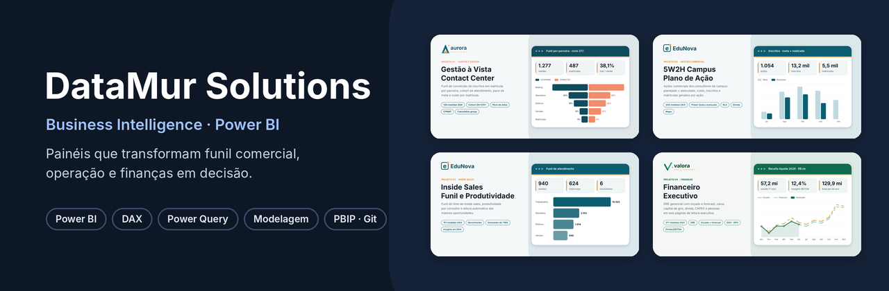
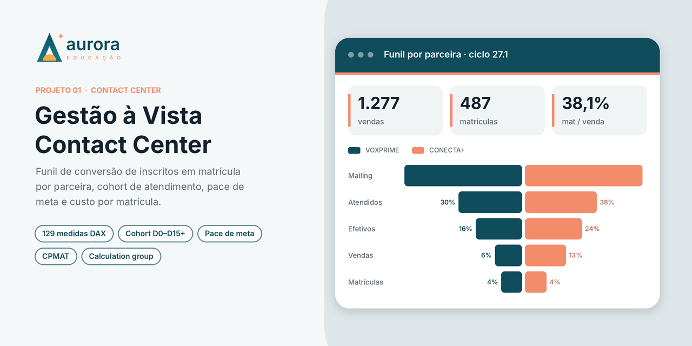
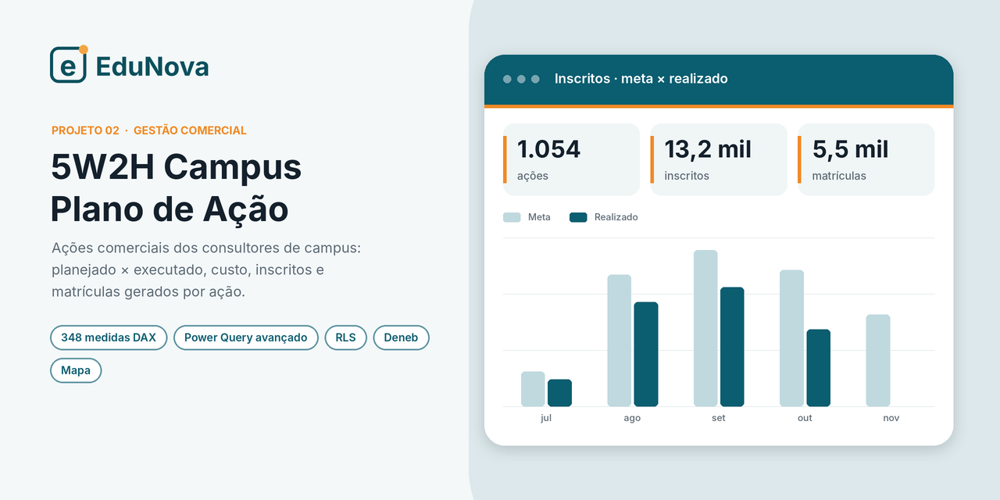
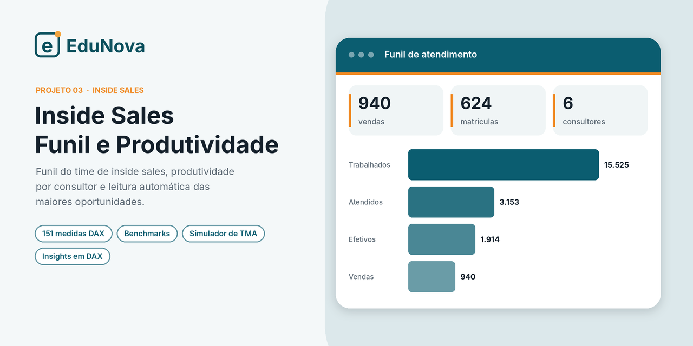
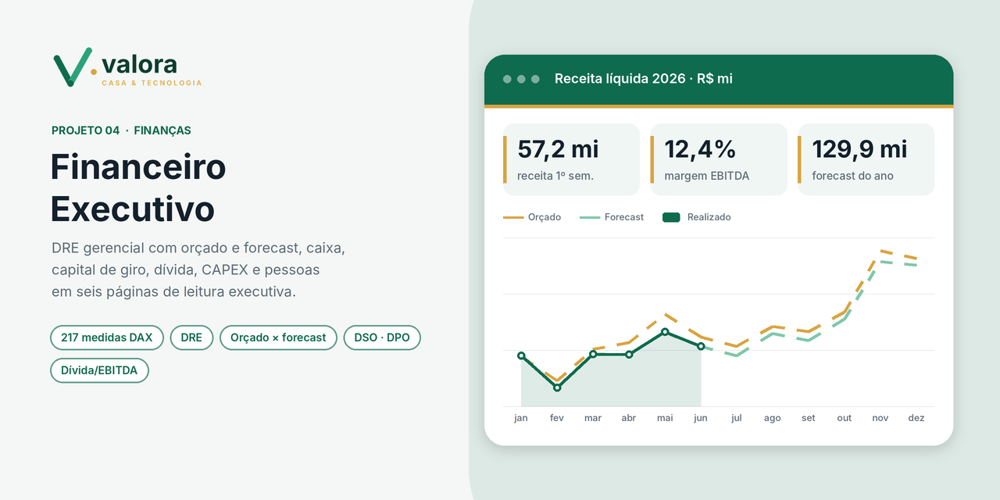

<p align="center">
  
</p>

# Portfólio de Business Intelligence · Power BI

**🌐 Site do portfólio: [datamur-solutions.github.io/portfolio-power-bi](https://datamur-solutions.github.io/portfolio-power-bi/)** · projetos, análises e downloads

Sou **Murillo Jesus**, analista de Planejamento e Inteligência Comercial e fundador da **DataMur Solutions**.
Construo painéis que acompanham o funil de conversão (de inscrito a matriculado), a operação de times
comerciais e de contact center e a saúde financeira da empresa, sempre com foco em **decisão**: o que
está fora da meta, onde está o gap e qual alavanca move o resultado.

> **Sobre os dados:** todos os projetos deste repositório usam **marcas, pessoas, unidades e números
> fictícios**, gerados para portfólio. A estrutura do modelo, as regras de negócio e as análises
> reproduzem o trabalho real, sem nenhuma informação de empresas ou clientes.

📫 **Contato:** [LinkedIn](https://www.linkedin.com/in/murillo-mateus-832202230/) · [murillomateus@gmail.com](mailto:murillomateus@gmail.com)

---

## Projetos

<table>
<tr>
<td width="50%" valign="top">
<a href="projetos/01-gestao-a-vista-contact-center"></a>

### [Gestão à Vista · Contact Center](projetos/01-gestao-a-vista-contact-center)
Funil de conversão de inscritos em matrículas por parceira de contact center, cohort de atendimento
(D0 a D15+), pace de meta, produtividade por posição de atendimento e custo por matrícula.

`Funil` `Cohort` `Pace e meta` `CPMAT` `Calculation group` `Parâmetros de campo`
</td>
<td width="50%" valign="top">
<a href="projetos/02-5w2h-campus"></a>

### [5W2H Campus · Plano de Ação Comercial](projetos/02-5w2h-campus)
Gestão das ações comerciais dos consultores: o que foi planejado (5W2H), o que foi executado,
quanto custou e quantos inscritos e matrículas gerou, com cobertura da equipe e mapa por estado.

`Power Query avançado` `RLS` `Mapa` `Deneb` `Diagnóstico de dados`
</td>
</tr>
<tr>
<td width="50%" valign="top">
<a href="projetos/03-inside-sales"></a>

### [Inside Sales · Funil e Produtividade](projetos/03-inside-sales)
Funil do time de inside sales, produtividade por consultor, desempenho por curso, cohort de
atendimento e leitura automática das maiores oportunidades.

`Funil` `Produtividade` `Benchmarks` `Insights em DAX`
</td>
<td width="50%" valign="top">
<a href="projetos/04-financeiro-executivo"></a>

### [Financeiro Executivo](projetos/04-financeiro-executivo)
DRE gerencial com orçado e forecast, caixa e liquidez, capital de giro (DSO, DPO, aging), dívida,
CAPEX e custo de pessoal, em seis páginas de leitura executiva.

`DRE` `Orçado × forecast` `Capital de giro` `Dívida/EBITDA` `Ponte de resultado`
</td>
</tr>
</table>

> 🧭 **Também no portfólio:** [Central de Campanhas](https://github.com/datamur-solutions/central-campanhas), uma aplicação web de governança de campanhas de contact center ([demonstração](https://datamur-solutions.github.io/central-campanhas/)).

> 🔜 **Em breve:** *Comercial 360 · Valora Casa & Tecnologia*, com vendas, canais, produtos e
> vendedores, integrado à receita do Financeiro Executivo.

---

## O que estes projetos mostram

| Competência | Onde aparece |
|---|---|
| **Modelagem dimensional** (fatos, dimensões, calendário, relacionamentos) | Todos os projetos |
| **DAX avançado**: inteligência de tempo, cohort, pace, comparáveis (mesmos meses), textos de leitura e cores condicionais | Gestão à Vista · Financeiro Executivo |
| **Power Query (M)**: mapas de colunas por nome interno, grade consultor × semana, diagnóstico de qualidade da base | 5W2H Campus |
| **Segurança por linha (RLS)** para consultor, coordenador e gerente | 5W2H Campus |
| **Indicadores comerciais**: funil, alô, efetividade, conversão, produtividade por posição de atendimento, CPMAT | Gestão à Vista · Inside Sales |
| **Indicadores financeiros**: DRE, EBITDA, orçado × forecast, DSO, DPO, ciclo financeiro, liquidez, dívida/EBITDA | Financeiro Executivo |
| **Design de relatório**: grade, hierarquia visual, identidade de marca, navegação por abas | Todos os projetos |
| **Versionamento**: projetos no formato **PBIP** (TMDL + PBIR), legíveis e comparáveis no Git | Todos os projetos |

---

## Como abrir os projetos

1. Instale o **[Power BI Desktop](https://powerbi.microsoft.com/desktop/)** (versão recente, com suporte a projetos PBIP).
2. Baixe o repositório: **Code → Download ZIP** e extraia, ou `git clone`.
3. Abra a pasta do projeto e dê dois cliques no arquivo **`.pbip`**.
4. Clique em **Atualizar**. Os dados fictícios estão **embutidos no próprio modelo**: não há
   arquivo externo, banco de dados nem credencial a configurar.

> Se o Power BI avisar que *“objetos calculados precisam ser atualizados”*, basta clicar em
> **Atualizar agora**. Isso é normal na primeira abertura de um projeto sem cache.

---

## Estrutura do repositório

```
├── assets/                          capas e banner do portfólio
└── projetos/
    ├── 01-gestao-a-vista-contact-center/
    ├── 02-5w2h-campus/
    ├── 03-inside-sales/
    └── 04-financeiro-executivo/
        ├── README.md                contexto, análises e destaques técnicos
        ├── *.pbip                   arquivo que abre o projeto
        ├── *.Report/                relatório (PBIR: páginas e visuais em JSON)
        └── *.SemanticModel/         modelo (TMDL: tabelas, medidas, relacionamentos)
```

---

<p align="center"><sub>© DataMur Solutions · projetos de portfólio com dados fictícios. Reprodução do conteúdo apenas com autorização.</sub></p>
