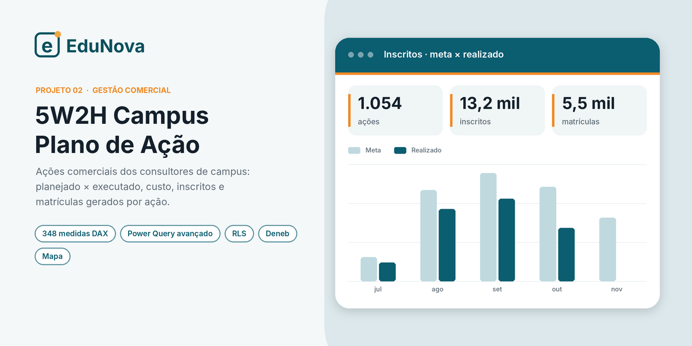

# 5W2H Campus · Plano de Ação Comercial

**Marca fictícia:** EduNova · **Data de referência:** 23/10/2026

## Contexto

Os consultores de campus registram suas ações comerciais no formato **5W2H**: o quê, por quê, onde,
quando, quem, como e quanto. Cada ação tem meta de inscritos e matrículas e um custo previsto. No
fechamento, o consultor lança o realizado. O painel transforma esse registro em gestão:

1. **A equipe está planejando?** Cobertura de consultores e de unidades com ação cadastrada.
2. **As ações estão sendo executadas e fechadas?** Status, ações vencidas e disciplina de registro.
3. **As ações dão resultado?** Inscritos, matrículas, conversão e custo por inscrito e por matrícula.

## Páginas e análises

| Página | O que mostra |
|---|---|
| **Visão executiva** | Projeção × realizado de inscritos e matrículas, custo, plano preenchido, alertas automáticos |
| **Cobertura de consultores** | Quem está em ação, quem só tem ação futura e quem está sem plano; quem cadastra e se cadastra no prazo |
| **Cobertura de produtos** | Matriz unidade × produto que destaca onde não há nenhuma ação |
| **Projeção de inscritos** | Pace de inscritos, tendência de fechamento e **simulador de ganho de ritmo** |
| **Conversão e projeção de matrícula** | Matrículas a cada 100 inscritos por regional, tipo de ação e alavanca |
| **Custo das ações** | Previsto × realizado, estouro de custo, custo por inscrito e por matrícula |
| **Execução das ações** | Status (realizada, parcial, não realizada) por semana e por unidade |
| **Ações vencidas** | Lista de cobrança: ações que passaram do prazo sem fechamento |
| **Mapa** | Cobertura do plano por estado e unidades por cidade |
| **Diagnóstico** | Qualidade da base: colunas não encontradas, campos vazios, inconsistências de data |
| **Como ler** | Guia de leitura dos indicadores |

## Destaques técnicos

- **348 medidas DAX** organizadas por pasta (janela de datas, pace, execução, cobertura, custo, alertas).
- **Power Query avançado**:
  - leitura das listas **pelo nome interno das colunas**, que não quebra quando alguém renomeia um título;
  - normalização de tipos (datas em UTC, números e booleanos);
  - **grade consultor × semana** e agenda das ações por dia útil;
  - abertura das metas por produto e modalidade;
  - localização da UF a partir do nome da unidade, para o mapa.
- **Segurança por linha (RLS)** com três perfis: consultor, coordenador e gerente.
- Visual **Deneb** (Vega-Lite) para a conversão por unidade em relação à média.
- Página de **diagnóstico** que audita a própria base de dados.

## Como abrir

Abra o arquivo **`.pbip`** no Power BI Desktop e clique em **Atualizar**. Os dados (1.054 ações e 50 consultores) estão embutidos no modelo.
