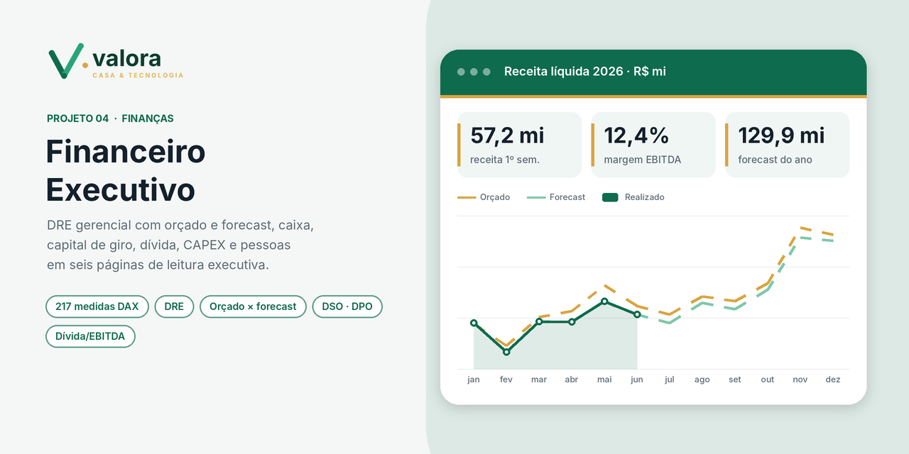

# Financeiro Executivo

**Marca fictícia:** Valora Casa & Tecnologia (varejo de casa e tecnologia) · **Realizado até:** 30/06/2026 · **Orçado e forecast até:** 12/2026

## Contexto

Painel de diretoria financeira em **seis páginas de 1920 × 1080**, com navegação por abas e filtros
de ano, mês, regional e unidade sincronizados entre as páginas. Cada indicador traz uma linha de
leitura que compara com o orçado e com o ano anterior, em verde quando está na meta e em laranja quando não está.

> **Comparável:** o orçado e o ano anterior são sempre comparados **nos mesmos meses** que já têm
> realizado. Assim, seis meses de realizado não são comparados com doze de orçamento.

## Páginas e análises

| Página | Pergunta que responde | Principais análises |
|---|---|---|
| **Visão executiva** | A empresa está entregando o resultado? | Receita, margens, EBITDA, resultado e caixa; receita mensal realizado × orçado × forecast; ponte da receita bruta ao lucro; margens mensais; saúde financeira; alertas |
| **DRE gerencial** | Onde está o desvio? | DRE por linha e conta com orçado comparável, variação em R$ e %, e análise vertical; estrutura de custos mensal; OPEX por natureza e por centro de custo |
| **Orçado × forecast** | Vamos bater o ano? | Atingimento e gap de receita e EBITDA; forecast de fechamento; desempenho e gap por unidade |
| **Caixa e liquidez** | O caixa sustenta a operação? | Saldo realizado × projetado; fluxo por atividade; entradas × saídas; categorias de entrada e saída |
| **Capital de giro** | O ciclo financeiro está saudável? | DSO, DPO e ciclo financeiro; aging de recebíveis e pagáveis; vencimentos × recebimentos; maiores saldos por cliente; pontualidade |
| **Dívida, CAPEX e pessoas** | A estrutura cabe no resultado? | Saldo devedor, dívida/EBITDA 12M, cobertura do serviço da dívida; juros e amortização; CAPEX por categoria; custo de pessoal |

## A história dos dados

A receita cresce **25%** sobre o 1º semestre do ano anterior, mas fica **5% abaixo do orçado**.
A margem EBITDA realizada (**12,4%**) está abaixo da orçada (**14,5%**), pressionada pelo custo da
mercadoria e pelo OPEX. O forecast projeta fechar o ano com margem de **13%**. O painel mostra em
quais linhas, unidades e meses está o desvio.

## Destaques técnicos

- **217 medidas DAX** em 20 tabelas (DRE, orçamento e forecast, caixa, recebíveis, pagáveis, dívida, CAPEX e folha).
- **Medidas comparáveis** (orçado e ano anterior nos mesmos meses do realizado) e **indicadores 12M** limitados ao último mês realizado.
- **Ponte de resultado** (waterfall) e **textos de leitura com cor condicional** gerados em DAX.
- Ordenação contábil da DRE, aging ordenado e calendário com mês/ano.
- Layout com fundo desenhado em grade: cada visual tem o seu cartão alinhado por trás.
- A receita, o CMV, o frete e as comissões vêm das mesmas vendas do painel *Comercial 360* (em breve no portfólio).

## Como abrir

Abra o arquivo **`.pbip`** no Power BI Desktop e clique em **Atualizar**. O filtro de ano abre em 2026.
